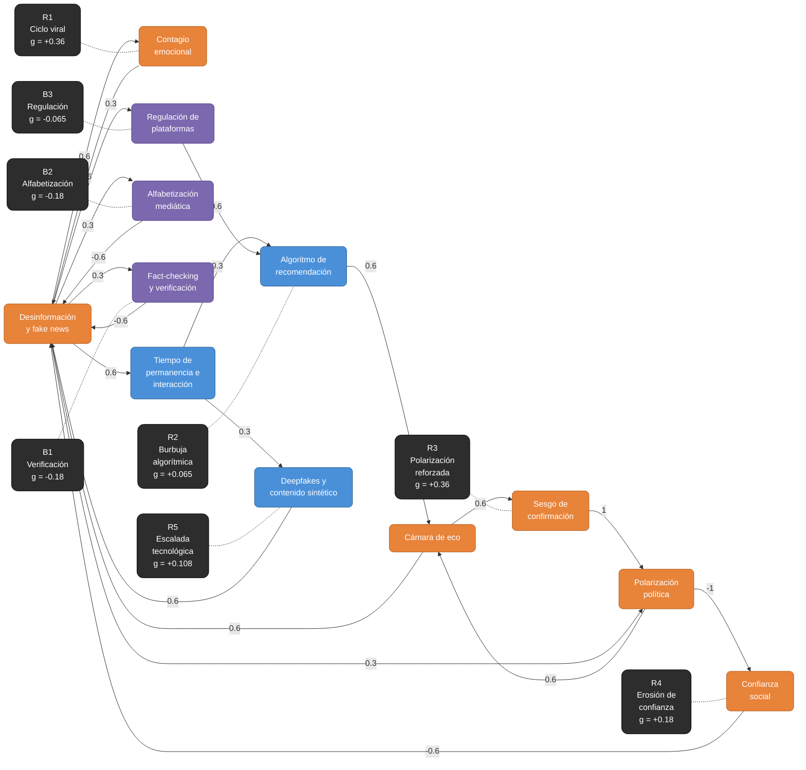

# Matriz de Influencia W — Modelo de Bucles Causales (Desinformación en redes sociales)

## 1. Diagrama de bucles causales (Mermaid)

---

## 2. Convención de la matriz

La matriz es de tipo **influencia directa** (estilo DEMATEL):

$$w_{ij} = \text{influencia de la causa } X_j \text{ sobre el efecto } X_i$$

- **Fila i** = variable **efecto** (quién recibe la influencia)
- **Columna j** = variable **causa** (de quién viene)
- Si en el diagrama existe la flecha `A → B` con peso `p`, el valor va en **fila B, columna A** ($w_{BA} = p$).
- **Diagonal = 0** (una variable no se influye a sí misma directamente).
- **Escala permitida:** $\{-1;\ -0.6;\ -0.3;\ 0;\ 0.3;\ 0.6;\ 1\}$

### Significado de los valores

| Valor | Interpretación                                      |
| ----- | --------------------------------------------------- |
| +1    | Influencia positiva máxima (relación casi mecánica) |
| +0.6  | Influencia positiva fuerte                          |
| +0.3  | Influencia positiva débil / indirecta               |
| 0     | Sin relación directa                                |
| -0.3  | Influencia negativa débil / indirecta               |
| -0.6  | Influencia negativa fuerte                          |
| -1    | Influencia negativa máxima                          |

### Variables del modelo

| Código | Variable                            | Categoría     |
| ------ | ----------------------------------- | ------------- |
| X1     | Desinformación y fake news          | Social        |
| X2     | Contagio emocional                  | Social        |
| X3     | Algoritmo de recomendación          | Tecnología    |
| X4     | Tiempo de permanencia e interacción | Tecnología    |
| X5     | Cámara de eco                       | Social        |
| X6     | Sesgo de confirmación               | Social        |
| X7     | Polarización política               | Social        |
| X8     | Confianza social                    | Social        |
| X9     | Alfabetización mediática            | Institucional |
| X10    | Fact-checking y verificación        | Institucional |
| X11    | Regulación de plataformas           | Institucional |
| X12    | Deepfakes y contenido sintético     | Tecnología    |

---

## 3. Matriz de Influencia Directa W (12 × 12)

$$
W = \begin{pmatrix}
0      & 0.6   & 0     & 0     & 0.6   & 0     & -0.6  & -0.6  & -0.6  & -0.6  & 0     & 0.6   \\
0.6    & 0     & 0     & 0     & 0     & 0     & 0     & 0     & 0     & 0     & 0     & 0     \\
0      & 0     & 0     & 0.3   & 0     & 0     & 0     & 0     & 0     & 0     & -0.6  & 0     \\
0.6    & 0     & 0     & 0     & 0     & 0     & 0     & 0     & 0     & 0     & 0     & 0     \\
0      & 0     & 0.6   & 0     & 0     & 0     & 0.6   & 0     & 0     & 0     & 0     & 0     \\
0      & 0     & 0     & 0     & 0.6   & 0     & 0     & 0     & 0     & 0     & 0     & 0     \\
0.3    & 0     & 0     & 0     & 0     & 1     & 0     & 0     & 0     & 0     & 0     & 0     \\
0      & 0     & 0     & 0     & 0     & 0     & -1    & 0     & 0     & 0     & 0     & 0     \\
0.3    & 0     & 0     & 0     & 0     & 0     & 0     & 0     & 0     & 0     & 0     & 0     \\
0.3    & 0     & 0     & 0     & 0     & 0     & 0     & 0     & 0     & 0     & 0     & 0     \\
0.3    & 0     & 0     & 0     & 0     & 0     & 0     & 0     & 0     & 0     & 0     & 0     \\
0      & 0     & 0     & 0.3   & 0     & 0     & 0     & 0     & 0     & 0     & 0     & 0
\end{pmatrix}
$$

### Representación tabular

|         | X1  | X2  | X3  | X4  | X5  | X6  | X7   | X8   | X9   | X10  | X11  | X12 | Σ abs |
| ------- | --- | --- | --- | --- | --- | --- | ---- | ---- | ---- | ---- | ---- | --- | ----- |
| **X1**  | 0   | 0.6 | 0   | 0   | 0.6 | 0   | -0.6 | -0.6 | -0.6 | -0.6 | 0    | 0.6 | 4.2   |
| **X2**  | 0.6 | 0   | 0   | 0   | 0   | 0   | 0    | 0    | 0    | 0    | 0    | 0   | 0.6   |
| **X3**  | 0   | 0   | 0   | 0.3 | 0   | 0   | 0    | 0    | 0    | 0    | -0.6 | 0   | 0.9   |
| **X4**  | 0.6 | 0   | 0   | 0   | 0   | 0   | 0    | 0    | 0    | 0    | 0    | 0   | 0.6   |
| **X5**  | 0   | 0   | 0.6 | 0   | 0   | 0   | 0.6  | 0    | 0    | 0    | 0    | 0   | 1.2   |
| **X6**  | 0   | 0   | 0   | 0   | 0.6 | 0   | 0    | 0    | 0    | 0    | 0    | 0   | 0.6   |
| **X7**  | 0.3 | 0   | 0   | 0   | 0   | 1   | 0    | 0    | 0    | 0    | 0    | 0   | 1.3   |
| **X8**  | 0   | 0   | 0   | 0   | 0   | 0   | -1   | 0    | 0    | 0    | 0    | 0   | 1.0   |
| **X9**  | 0.3 | 0   | 0   | 0   | 0   | 0   | 0    | 0    | 0    | 0    | 0    | 0   | 0.3   |
| **X10** | 0.3 | 0   | 0   | 0   | 0   | 0   | 0    | 0    | 0    | 0    | 0    | 0   | 0.3   |
| **X11** | 0.3 | 0   | 0   | 0   | 0   | 0   | 0    | 0    | 0    | 0    | 0    | 0   | 0.3   |
| **X12** | 0   | 0   | 0   | 0.3 | 0   | 0   | 0    | 0    | 0    | 0    | 0    | 0   | 0.3   |

**Chequeo:** 20 flechas en el diagrama = 20 elementos ≠ 0 en la matriz; diagonal completa en 0 ✔️

---

## 4. Correspondencia flecha ↔ elemento de la matriz

| #   | Flecha (causa → efecto) | Peso | Posición en W |
| --- | ----------------------- | ---- | ------------- |
| 1   | X1 → X2                 | 0.6  | $w_{21}$      |
| 2   | X2 → X1                 | 0.6  | $w_{12}$      |
| 3   | X1 → X4                 | 0.6  | $w_{41}$      |
| 4   | X4 → X3                 | 0.3  | $w_{34}$      |
| 5   | X3 → X5                 | 0.6  | $w_{53}$      |
| 6   | X5 → X1                 | 0.6  | $w_{15}$      |
| 7   | X5 → X6                 | 0.6  | $w_{65}$      |
| 8   | X6 → X7                 | 1    | $w_{76}$      |
| 9   | X7 → X5                 | 0.6  | $w_{57}$      |
| 10  | X1 → X7                 | 0.3  | $w_{71}$      |
| 11  | X7 → X8                 | -1   | $w_{87}$      |
| 12  | X8 → X1                 | -0.6 | $w_{18}$      |
| 13  | X12 → X1                | 0.6  | $w_{1,12}$    |
| 14  | X4 → X12                | 0.3  | $w_{12,4}$    |
| 15  | X1 → X10                | 0.3  | $w_{10,1}$    |
| 16  | X10 → X1                | -0.6 | $w_{1,10}$    |
| 17  | X1 → X9                 | 0.3  | $w_{91}$      |
| 18  | X9 → X1                 | -0.6 | $w_{19}$      |
| 19  | X1 → X11                | 0.3  | $w_{11,1}$    |
| 20  | X11 → X3                | -0.6 | $w_{3,11}$    |

---

## 5. Análisis de bucles (ganancia = producto de los pesos)

| Bucle                       | Recorrido               | Cálculo                                   | Ganancia (g) | Tipo                 |
| --------------------------- | ----------------------- | ----------------------------------------- | ------------ | -------------------- |
| R1 — Ciclo viral            | X1 → X2 → X1            | $0.6 \times 0.6$                          | **+0.36**    | Reforzante fuerte    |
| R2 — Burbuja algorítmica    | X1 → X4 → X3 → X5 → X1  | $0.6 \times 0.3 \times 0.6 \times 0.6$    | **+0.065**   | Reforzante débil     |
| R3 — Polarización reforzada | X5 → X6 → X7 → X5       | $0.6 \times 1 \times 0.6$                 | **+0.36**    | Reforzante fuerte    |
| R4 — Erosión de confianza   | X1 → X7 → X8 → X1       | $0.3 \times (-1) \times (-0.6)$           | **+0.18**    | Reforzante moderado  |
| R5 — Escalada tecnológica   | X1 → X4 → X12 → X1      | $0.6 \times 0.3 \times 0.6$               | **+0.108**   | Reforzante débil     |
| B1 — Verificación           | X1 → X10 → X1           | $0.3 \times (-0.6)$                       | **-0.18**    | Compensador moderado |
| B2 — Alfabetización         | X1 → X9 → X1            | $0.3 \times (-0.6)$                       | **-0.18**    | Compensador moderado |
| B3 — Regulación             | X1 → X11 → X3 → X5 → X1 | $0.3 \times (-0.6) \times 0.6 \times 0.6$ | **-0.065**   | Compensador débil    |

### Interpretación

- **Regla de signos:** producto positivo → bucle reforzante (R); producto negativo → bucle compensador (B).
- **Conclusión del modelo:** todos los bucles reforzantes (máx. +0.36) superan en magnitud a los compensadores (máx. -0.18). El sistema tiende al **desequilibrio**: la desinformación se propaga más rápido de lo que los mecanismos correctivos (verificación, alfabetización, regulación) pueden contenerla.

---

## 6. Justificación de los pesos

| Valor asignado       | Criterio                                                                                                |
| -------------------- | ------------------------------------------------------------------------------------------------------- |
| 1 (X6 → X7, X7 → X8) | Relación casi mecánica / causa-directa reportada en literatura                                          |
| 0.6                  | Relación directa fuerte, con otros factores de por medio                                                |
| 0.3                  | Relación indirecta, lenta o dependiente de factores externos (políticos, presupuestarios, tecnológicos) |

Ejemplos de por qué ciertos enlaces valen 0.3:

- **X4 → X3**: el algoritmo utiliza decenas de señales (clics, likes, horario, sesión); el tiempo de permanencia es solo una de ellas.
- **X1 → X7**: el efecto es indirecto, mediado por identificación partidista y exposición selectiva.
- **X1 → X11**: la regulación es lenta y política; depende de lobby, ciclos electorales e intereses de las plataformas.
- **X1 → X9 / X1 → X10**: las respuestas institucionales (alfabetización, fact-checking) dependen de presupuesto y voluntad política, no reaccionan 1:1 con la desinformación.

---

## 7. Extensión DEMATEL (opcional)

Para influencia **total**, se normaliza por la suma absoluta máxima de fila (X1: Σ = 4.2):

$$\lambda = \frac{1}{4.2} \approx 0.238, \qquad \tilde{W} = \lambda W, \qquad T = \tilde{W}(I - \tilde{W})^{-1}$$

Con $T$ se calculan $D_i - R_i$ (prominencia neta: variables **causa**) y $D_i + R_i$ (relación total) para clasificar cada variable como emisora o receptora neta de influencia.
